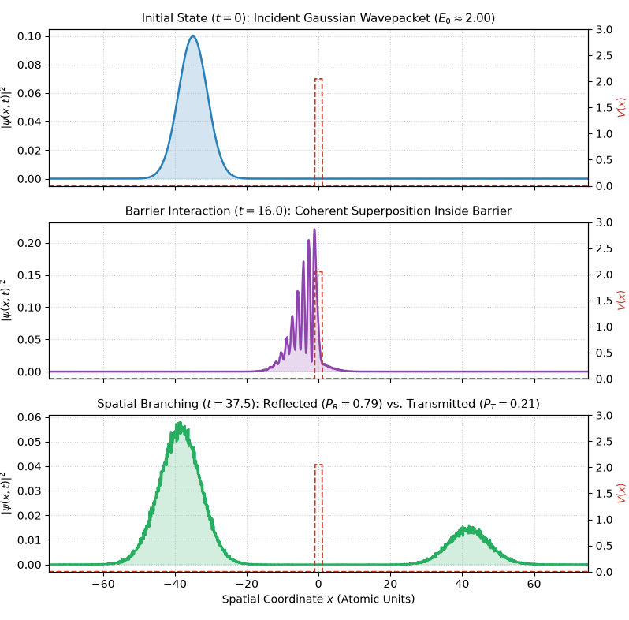
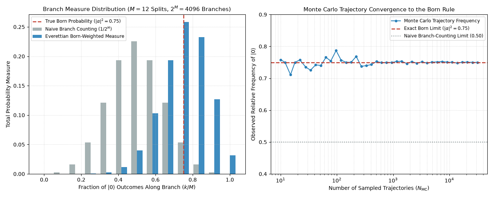
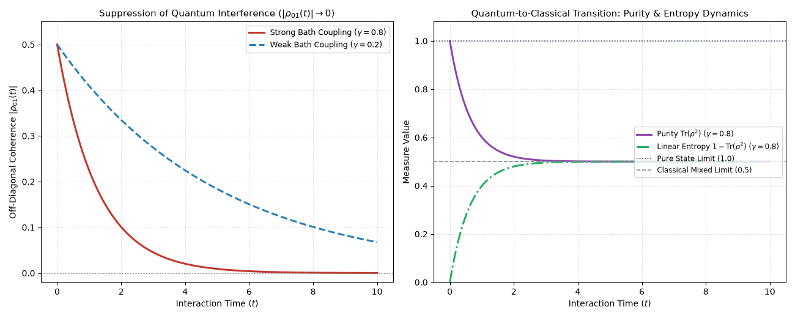

# Open Quantum Systems, Wavepacket Branching & Decoherence Simulator

A numerical Python framework modeling spatial quantum wavepacket branching, sequential unitary measurement trees, stochastic Monte Carlo Born-rule convergence, and environmental decoherence in open quantum systems.

## Project Overview
This repository translates foundational questions in quantum measurement theory and molecular quantum dynamics into quantitative physical chemistry simulations:
1. **TDSE Wavepacket Scattering & Spatial Branching (`wavepacket_splitting.py`)**: Solves the 1D Time-Dependent Schrödinger Equation (TDSE) using the Split-Operator Fourier Method (SOFM) to track a Gaussian wavepacket scattering off a finite potential barrier ($V_0 \approx E_0$), illustrating coherent spatial branching into reflected and transmitted probability channels while preserving total norm ($\int |\psi(x,t)|^2\,dx = 1$).
2. **Everettian Branching & Monte Carlo Sampling (`everett_branching_mc.py`)**: Evaluates the full $2^M$ branching tree of sequential quantum measurements ($|\psi\rangle = \alpha|0\rangle + \beta|1\rangle$) and runs stochastic Monte Carlo trajectory sampling to demonstrate how observer worldline frequencies converge to the exact Born rule ($|\alpha|^2$) rather than naive branch counting ($1/2^M$).
3. **Reduced Density-Matrix Decoherence (`decoherence_purity.py`)**: Models pure environmental dephasing of a two-level quantum system coupled to an external bath, tracking the exponential suppression of off-diagonal quantum coherences ($|\rho_{01}(t)| \to 0$) and the loss of state purity ($\mathrm{Tr}(\rho^2) \to 0.5$) across weak and strong coupling regimes.

## Technical Stack
* Language: Python 3.x
* Core Libraries: `NumPy` (Fast Fourier Transforms `np.fft`, complex density-matrix algebra, and vectorized Monte Carlo sampling), `SciPy` (combinatorial branch enumeration), `Matplotlib` (multi-panel scientific visualization)
* Numerical Methods: Symmetric Trotter Split-Operator Fourier Method (SOFM), Monte Carlo trajectory integration, reduced density-matrix evolution

## Key Results & Visualizations

### 1. Spatial Wavepacket Branching via Split-Operator Fourier Method
* Script: `wavepacket_splitting.py`
* Description: Propagates a normalized Gaussian wavepacket ($E_0 \approx 2.0\text{ a.u.}$) across a finite potential barrier ($V_0 = 2.05\text{ a.u.}$) by alternating between position-space potential operators and momentum-space kinetic propagators via Fast Fourier Transforms, capturing the coherent split into reflected ($P_R$) and transmitted ($P_T$) branches.


### 2. Everettian Branch Measure & Monte Carlo Born-Rule Convergence
* Script: `everett_branching_mc.py`
* Description: Compares the naive branch-counting distribution against the Born-weighted measure across $M = 12$ sequential splits ($2^{12} = 4,096$ branches) for an asymmetric superposition ($|\alpha|^2 = 0.75$), and tracks Monte Carlo trajectory convergence across $N_{\mathrm{MC}} \in [10^1, 10^{4.5}]$ sampled worldlines.


### 3. Environmental Decoherence & Purity Loss
* Script: `decoherence_purity.py`
* Description: Evolves an initially pure equal superposition state ($\mathrm{Tr}(\rho^2) = 1$) under weak ( $\gamma = 0.2 $ ) and strong ($\gamma = 0.8$) environmental bath coupling, illustrating the decay of off-diagonal interference terms and the growth of linear entropy ( $ S_L = 1 - \mathrm{Tr}(\rho^2) $ ) during the quantum-to-classical transition.


## Key Scientific Takeaways
* Unitary Spatial Branching: Alternating kinetic ($\hat{T}$) and potential ($\hat{V}$) evolution in Fourier and position space preserves unitarity, showing how a localized wavepacket bifurcates into orthogonal spatial branches upon encountering an energy barrier.
* Resolution of Naive Branch Counting: For asymmetric superpositions $|\alpha|^2 \neq |\beta|^2$, unweighted counting of the $2^M$ measurement branches peaks at $0.50$, whereas Born-weighted measure and stochastic Monte Carlo sampling converge to the exact Born probability ($|\alpha|^2 = 0.75$).
* Suppression of Quantum Interference & Purity Loss: Coupling a coherent superposition to environmental degrees of freedom causes exponential decay of off-diagonal density-matrix elements $|\rho_{01}(t)| = |\rho_{01}(0)|e^{-\gamma t}$, driving state purity from $\mathrm{Tr}(\rho^2) = 1$ (pure quantum state) to $\mathrm{Tr}(\rho^2) = 0.5$ (maximally mixed classical ensemble).

## Getting Started & Execution
To replicate these simulations locally, navigate to the project directory and run the scripts:

```powershell
cd "C:\Users\zeesh\open-quantum-decoherence"
python wavepacket_splitting.py
python everett_branching_mc.py
python decoherence_purity.py
